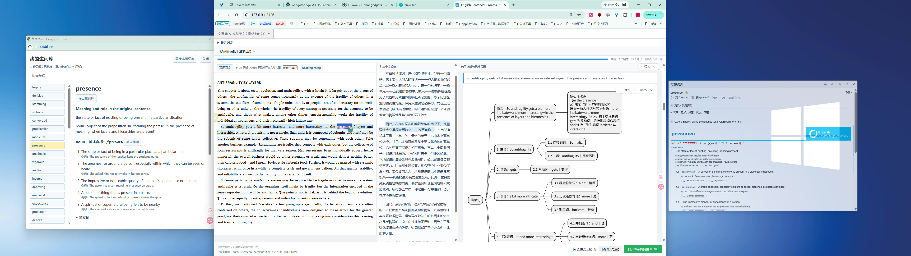

# English Sentences Process Decomposition

这是一个面向中文母语英语学习者的本地英文阅读工具，主要做两件事：拆解英文句子结构，以及整理阅读过程中遇到的生词。

导入文章或电子书后，可以逐句查看翻译和语法结构图，双击单词查词，并将生词保存到个人词库。已收录的词会在文章中标记，之后也能回看释义、例句和收录时的原句。目前支持 Windows 本机运行，通过浏览器打开。

粘贴文章 / 导入电子书 → 检查分段 → 逐句翻译与语法拆解 → 原文、译文、结构图对照阅读 → 查词与积累生词。

> 项目由 n8n 工作流演进为独立本地 Web 应用。安装向导负责准备运行环境；安装完成后，可通过桌面入口打开阅读器。

---

## 功能

- **分段预览与调整** — 修复 PDF 复制文本中的假换行，预览分段后可调整，再确认分析；也可保留原有段落。
- **逐句语法拆解** — DeepSeek 分析句型、主谓宾、从句和短语，由本机 PlantUML 生成结构图。
- **三栏对照与联动** — 英文原文、中文译文和语法图分栏显示，点击句子定位对应内容；栏宽可调，图形支持缩放、拖动和整图适配。
- **快速查词** — 双击英文单词查看释义、音标、例句及句中含义，可在独立查词窗口继续查阅。
- **个人生词库** — 手动收录单词，在文章中标记已收录词，回看释义、例句和收录时的原句；支持搜索与移出。
- **EPUB 阅读** — 保留书内排版、图片和字体，按目录选章或合并多章分析；缺少分章目录时可生成 AI 阅读目录并另存新版 EPUB。
- **文件上传与粘贴** — 支持直接粘贴文本，或上传 `.txt`、文本型 `.pdf`、`.epub`。扫描 PDF 和图片书暂不支持 OCR。
- **进度显示与继续分析** — 显示处理进度和时间预估，保存逐句分析进度，中断后可继续。
- **最近阅读与双屏** — 恢复书籍和阅读位置，也可把语法图放到独立窗口。
- **完整 HTML 笔记** — 结果自动保存，关闭浏览器和本地服务后，仍可打开已生成的原文、译文、图形与缓存词义。

## 快速开始

### 1. 打开安装程序

支持 **Windows 10 / 11 x64**。双击 `SentenceProcess-Setup.exe`，选择安装位置，点击 **检查准备情况**。

[下载安装程序（v2.0.0）](https://github.com/swaglee1016/Process-decomposition-of-English-sentences/releases/download/v2.0.0/SentenceProcess-Setup.exe) · [版本说明与校验文件](https://github.com/swaglee1016/Process-decomposition-of-English-sentences/releases/tag/v2.0.0)

> 安装包尚未进行数字签名，Windows 可能提示未知发布者，请核对下载来源。GitHub 自动生成的源码 ZIP 不等于安装程序。

### 2. 确认下载运行组件

向导会检查 Node.js、Java 和 PlantUML：已有且可用的直接使用，缺少的会先显示版本、来源和下载大小。

点击 **同意下载并安装** 后，程序自动下载、校验和准备组件，并显示当前进度。全部缺少时约下载 **93 MB**；失败后可以重试。无需自己输入命令，也不会覆盖系统已有的运行环境。

### 3. 填写 DeepSeek API Key

通过向导中的 DeepSeek 控制台入口获取自己的 API Key，粘贴到输入框，点击 **保存并完成安装**。勾选创建桌面快捷方式后，以后可双击 **英文精读** 打开。

密钥按当前 Windows 用户加密保存在本机。安装过程不调用 AI、不检查余额；实际分析、翻译和查词可能产生 API 费用。

### 4. 打开应用并导入内容

看到 **程序已安装完成** 后，点击 **立即打开**。阅读界面会在默认浏览器中打开：

1. 粘贴文章或上传文件；EPUB 先选择要阅读的目录条目。
2. 检查分段预览，必要时调整，再确认分析。
3. 点击句子对照译文与结构图，双击单词查词并按需收录。
4. 下次从“最近阅读”继续，或直接打开保存的 HTML 笔记。

没有创建快捷方式时，可运行安装目录中的 `Reader.exe`。首次使用建议先处理一小段文章。

下载失败、修改密钥、启动地址占用及开发者构建方式见 [安装说明](docs/INSTALL.md)。已有开发环境的用户也可按 [使用指南](docs/USER-GUIDE.md) 手动配置，通过 `start.bat` 或 `npm start` 启动。

## 界面说明

```text
┌──────────────────────────────────────────────────────────┐
│ 文章输入 / 文件上传 · 最近阅读 · EPUB 目录 · 分段预览       │
├──────────────────────────────────────────────────────────┤
│ 分析进度与时间预估                                        │
├──────────────────────┬──────────────┬────────────────────┤
│ 英文原文             │ 中文译文     │ 句子结构图         │
│                      │              │                    │
│ 点击句子，对照阅读   │ 对应句译文   │ 主谓宾 / 从句      │
│ 双击单词，快速查词   │              │ 短语 / 语法说明    │
│ 已收录词标记         │              │ 缩放、拖动与适配   │
├──────────────────────┴──────────────┴────────────────────┤
│ 阅读进度 · 生词库 · 打开保存的完整 HTML                    │
└──────────────────────────────────────────────────────────┘
```

- 点击原文或译文中的句子，定位对应语法图；滚动语法图时，原文对应句子联动高亮。
- 拖动栏边界调整阅读空间，各栏可独立滚动；输入区与工具栏可以折叠。
- 查词与生词库可在独立窗口中查看，结构图也可单独打开，方便多窗口或双屏阅读。

## 效果截图



[打开原尺寸截图](docs/images/reading-workspace.png)

截图中，左侧是本应用的生词库窗口，中间是英文原文、中文译文和句子结构图。选中的单词可以在词库中查看释义及原句中的作用。

右侧的 **欧路词典是另外安装的第三方软件**，不是本应用自带界面，也不是使用本应用查词功能的前提。截图展示的是多个窗口同时使用的状态。

## 项目结构

```text
public/                       ← 阅读界面与在线/离线共用交互
├── app.js                    ← 输入、分析进度与阅读界面
├── readingWorkspace.js       ← 三栏布局与双屏阅读
├── epubOriginal.js           ← EPUB 原版排版阅读
├── inlineDiagramCanvas.js    ← 图形缩放、拖动与按需初始化
└── vocabulary.js             ← 查词与生词库界面

services/                     ← 后端服务模块
├── deepseek.js               ← DeepSeek API 调用
├── paragraphSplitter.js      ← 分段整理与原文保留
├── textSplitter.js           ← 规则分句、缩写保护与原文位置
├── epubParser.js             ← EPUB 内容提取
├── plantumlRenderer.js       ← 本机 Java / PlantUML 绘图
├── htmlBuilder.js            ← 完整离线 HTML 拼装
├── resultPersistence.js      ← 结果文件持久化
├── vocabularyStore.js        ← SQLite 词库
└── readerSessionStore.js     ← 书籍与阅读状态保存

installer/                    ← Windows 安装向导与构建脚本
tests/                        ← 自动化测试及浏览器验收脚本
docs/                         ← 安装说明、使用指南与截图
data/                         ← 个人书籍、词库与阅读进度，不提交 Git
outputs/                      ← 生成的笔记和本地构建产物，不提交 Git
server.js                     ← Express 服务入口
launcher.js                   ← 本地启动与已有阅读窗口复用
start.bat                     ← 源码版启动脚本
```

以上为主要文件，完整代码以仓库目录为准。安装版的阅读程序位于安装目录的 `app/` 中，个人内容分别保存在 `app/data/` 和 `app/outputs/`。备份前停止阅读服务，再复制这两个目录；程序不会自动清理个人书籍或笔记。

## 技术栈

| 层 | 技术 |
|---|---|
| 后端 | Node.js + Express |
| 分析进度 | SSE（Server-Sent Events） |
| 文本分析 | DeepSeek API，默认模型 `deepseek-chat` |
| 语法图 | 本机 Java + PlantUML，SVG 优先，本机 PNG 回退 |
| 前端 | 原生 HTML / CSS / JavaScript |
| 文本分句 | 确定性规则扫描、缩写保护与原文区间记录 |
| 阅读联动 | 句子位置映射、滚动事件与 `IntersectionObserver` |
| 生词库 | Node.js 内置 SQLite |
| 安装向导 | C# / Windows Forms，Windows 当前用户加密保存密钥 |

图形在本机生成，不依赖 Docker 或在线图形渲染服务。DeepSeek 分析仍需联网。

## 工作原理

```text
粘贴文章 / 导入 TXT、PDF、EPUB
    │
    ▼
提取内容，选择 EPUB 章节
    │
    ▼
整理分段 → 预览与调整 → 用户确认
    │
    ▼
规则分句，保留原文位置
    │
    ▼
逐句调用 DeepSeek：翻译与语法分析
    │
    ▼
校验分析与原文的对应关系
    │
    ▼
本机 Java + PlantUML → SVG / PNG
    │
    ▼
原文、译文与语法图三栏联动
    │
    ▼
完整 HTML 写入 outputs/ → 显示完成 → 随时回看

阅读中双击单词 → 查词 → 手动收录
    │
    ▼
本地 SQLite 词库 → 原文标记 → 回看释义与原句
```

分析会将相关文本发送到 DeepSeek；查词发送单词，句中释义还会发送所在句。缺少分章目录的 EPUB 可能发送正文以生成 AI 阅读目录。AI 生成的翻译、语法与词义需要自行核对。

已生成内容可离线阅读；新增分析、生成词义需要联网，同步词库需要本地服务运行。导出的 HTML 可能包含个人词库快照及本机访问凭据，请按个人学习文件保管，不要直接公开上传。旧 HTML 不会随程序升级自动改变。

## 版本

- **v2.0.0** — Windows 安装向导、EPUB 原版阅读、三栏与双屏、查词和个人词库、阅读进度恢复、逐句继续分析、本地绘图及完整离线笔记。
- **v1.2** — 时间预估追踪与 `start.bat` 启动脚本。
- **v1.1** — AI 段落拆分与重试容错。
- **v1.0** — 初始版本，由 n8n 工作流迁移。

更多说明见 [更新记录](CHANGELOG.md)。
